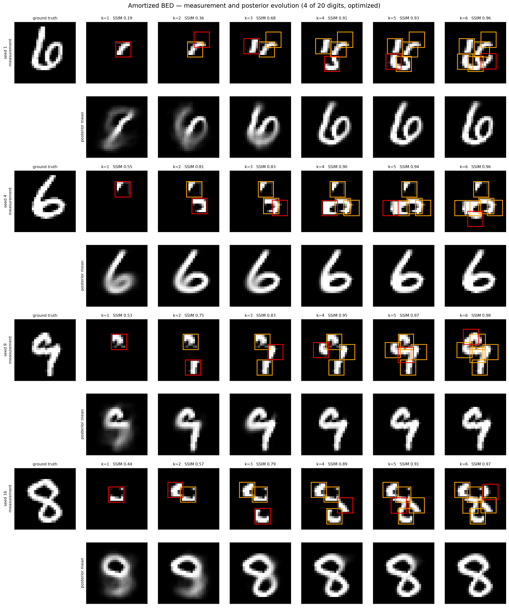
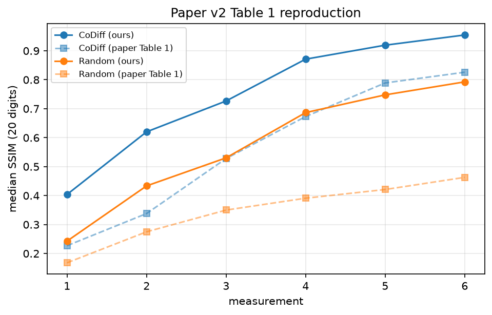

Code repository for the paper [Bayesian Experimental Design via Contrastive Diffusions](https://arxiv.org/abs/2410.11826)

> ### 🆕 Update — v2
>
> The MNIST network previously used in this repo was poorly trained, which made sampling
> digits high variance. This update ships a modern **conditional PixelDiT** trained to sample
> in fewer than 10 steps, and the improved sampling substantially improves the results
> published in the ICLR paper: median SSIM after 6 measurements goes from **0.83 to 0.96**.
>
> Because the network is conditioned on the measurements directly, sampling the posterior
> needs no guidance, filtering or resampling — the previous guidance-based samplers are gone.

CoDiff picks *where to measure* by maximizing the expected information gain (EIG) with a
contrastive estimator, differentiating through a diffusion posterior sampler.

# Measurement and posterior evolution

Each optimized measurement (red = newest, orange = earlier) and the posterior mean it induces:

<p align="center">
  
</p>

The designs land on the strokes that still discriminate between plausible digits, and the
posterior collapses onto the ground truth within a few measurements.

# Results

Median SSIM over 20 digits from the **held-out MNIST test set**, 6 sequential measurements:

| measurement | 1 | 2 | 3 | 4 | 5 | 6 |
|---|---|---|---|---|---|---|
| **CoDiff (v2)** | 0.404 | 0.620 | 0.727 | 0.871 | 0.919 | **0.955** |
| Random designs (v2) | 0.243 | 0.433 | 0.530 | 0.687 | 0.748 | 0.793 |
| CoDiff (paper, v1) | 0.227 | 0.338 | 0.528 | 0.673 | 0.789 | 0.826 |
| Random designs (paper, v1) | 0.168 | 0.275 | 0.350 | 0.391 | 0.421 | 0.463 |

Both v2 rows come from the published weights, over the same 20 held-out digits.

**Evaluation is on the held-out test set.** Numbers on training digits are within seed
noise of these (0.943 vs 0.955 at k=6), so the network is not memorizing.

<p align="center">
  
</p>

# Structure of the repository

- `models/`
    - `pixel_dit.py`: `PixelDiT` — pixel-space conditional velocity transformer (in-context
      conditioning, 2D RoPE, QK RMSNorm, SwiGLU). Predicts the flow-matching velocity
      `v(z_t, t | c)` with `c = [A_Ξ θ, mask_Ξ]`
- `design/`: core CoDiff implementation
    - `bayesian_design.py`: single-loop EIG maximization — joint sampling, pooled contrastive
      posterior, and gradient-based design updates (`ExperimentOptimizer`)
    - `forward_model.py`: `DesignForwardModel` protocol for adaptive measurement operators
    - `square_mask.py`: differentiable square-mask forward model for MNIST inpainting
- `scripts/`
    - `run_bed_amortized.py`: main entry point — sequential BED on MNIST, saves designs,
      measurements, samples and metrics to a `.npz`
    - `plot_measurement_evolution.py`, `plot_ssim_table.py`, `plot_comparison.py`,
      `ssim_variants.py`: post-hoc figures from the saved records

# Usage

Weights are on the Hub ([`jcopo/mnist`](https://huggingface.co/jcopo/mnist)) and download
automatically:

```bash
# optimized designs, 6 sequential measurements
python scripts/run_bed_amortized.py --num_meas 6 --out run.npz

# random-design baseline
python scripts/run_bed_amortized.py --num_meas 6 --design_mode random --out baseline.npz

# figures from the saved records
python scripts/plot_measurement_evolution.py runs
python scripts/plot_ssim_table.py runs
```

On an air-gapped cluster, fetch `model.msgpack` beforehand and pass `--weights /path/to/model.msgpack`.
The Hub revision is pinned in `run_bed_amortized.py`, so a missing cache entry fails loudly rather
than silently resolving to an older revision.

# Method

The EIG gradient uses the contrastive form

```
∇_ξ I(ξ) ≈ (1/N) Σ_i [ g(ξ, y_i, θ_i, θ_i) − Σ_j w_ij g(ξ, y_i, θ_i, θ'_j) ]
```

with `g = ∇_ξ log p(y | θ, ξ)` and self-normalized importance weights. Design updates are
interleaved with sampling steps in a single loop, so the posterior particles and the design
are refined together rather than in nested loops.

The posterior network is trained with a rectified-flow objective (target `v* = e − x` on
`z_t = (1−t)x + t e`), conditioned on a masked image and its mask, where the mask is a random
union of 1–6 soft squares — the same family the design forward model produces. Conditioning
dropout keeps the unconditional model available via zero conditioning.

# Dependencies

- [diffuse](https://github.com/GragasLab/diffuse): diffusion/flow models, integrators, conditional denoiser protocol
- JAX, Flax (nnx), Optax, dm-pix, einops — `models/pixel_dit.py` is self-contained, so
  nothing else is needed
- MNIST as `dataset/mnist.npz` (28×28, single channel)

# Citation

```bibtex
@article{iollo2024bayesian,
  title={Bayesian Experimental Design via Contrastive Diffusions},
  author={Iollo, Jacopo and Heinkel{\'e}, Christophe and Alliez, Pierre and Forbes, Florence},
  journal={arXiv preprint arXiv:2410.11826},
  year={2024}
}
```
